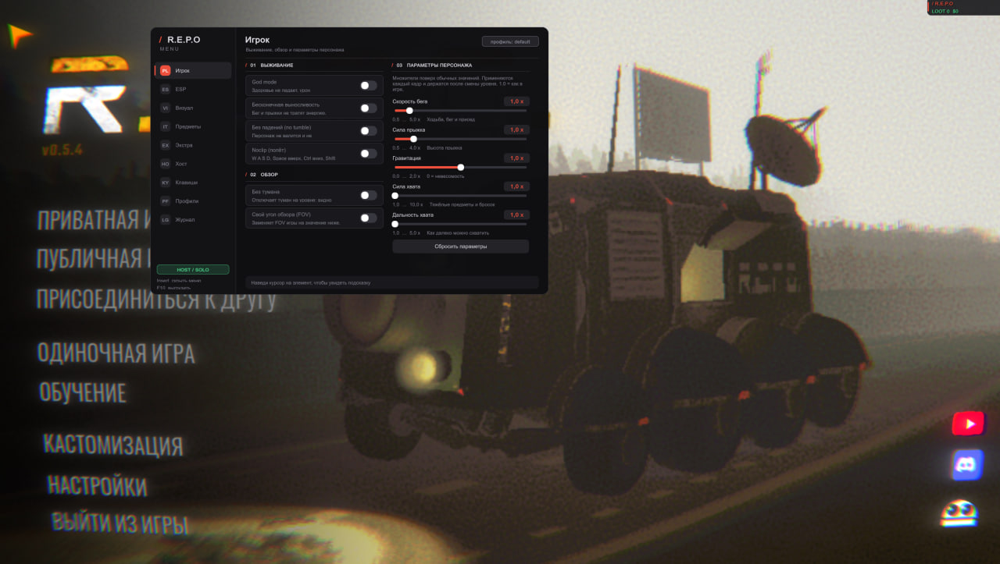

# REPOMenu — IMGUI mod menu for R.E.P.O. (Mono)

**English** · [Русский](#русский)





Modern in-game menu (rounded UI, animated toggles/sliders, sidebar tabs, tooltips) plus a one-click WinForms loader.

## Features
- **Player:** god mode, infinite stamina, no-clip, speed/jump, no tumble, heal/revive
- **ESP:** players, enemies, valuables, items, traps, chams, radar
- **Items:** spawner (valuables, money bag), set value, pull / pack / remote sell
- **Extra:** teleports, waypoints, freeze enemies, kill aura, free shop, upgrades
- **Host-only:** actions on other players, enemy spawner
- Hotkeys, config profiles, log tab. Open/close menu: `INSERT`; unload: `F10`.

## Requirements
- Windows, R.E.P.O. (Steam, Mono build), [.NET SDK](https://dotnet.microsoft.com/download) (any recent, builds net48)
- `SharpMonoInjector.dll` in `libs/` (see `libs/README.md`)

## Build
```
build.bat
```
The game folder is found automatically (running process, Steam registry, `libraryfolders.vdf`, common paths).
Override: set `REPO_PATH`, or `dotnet build -p:GamePath="D:\Games\...\REPO"`, or edit `GamePath.props`.
Result: `dist\Loader.exe`, `REPOMenu.dll`, `SharpMonoInjector.dll` (keep together).

## Use
1. Run `dist\Loader.exe`, press **Start**, launch the game.
2. The loader waits for Mono, injects, and minimizes to tray.

## Notes
Not affiliated with the game's developers. Use at your own risk, offline/private lobbies recommended. No game assemblies are included; they are referenced from your own install.

---

## Русский

Современное внутриигровое меню (скруглённый UI, анимированные переключатели и ползунки, боковые вкладки, подсказки) и лоадер «нажал и работает».

### Возможности
- **Игрок:** бессмертие, бесконечная выносливость, noclip, скорость/прыжок, без падений, лечение/воскрешение
- **ESP:** игроки, мобы, ценности, предметы, ловушки, chams, радар
- **Предметы:** спавнер (ценности, мешок денег), задать цену, притянуть / упаковать / продать удалённо
- **Экстра:** телепорты, метки, заморозка мобов, kill aura, бесплатный магазин, апгрейды
- **Только хост:** действия над другими игроками, спавн мобов
- Горячие клавиши, профили, журнал. Меню: `INSERT`; выгрузка: `F10`.

### Требования
- Windows, R.E.P.O. (Steam, Mono), [.NET SDK](https://dotnet.microsoft.com/download)
- `SharpMonoInjector.dll` в папке `libs/` (см. `libs/README.md`)

### Сборка
```
build.bat
```
Папка игры ищется автоматически (процесс, реестр Steam, `libraryfolders.vdf`, типовые пути).
Вручную: переменная `REPO_PATH`, или `dotnet build -p:GamePath="D:\...\REPO"`, или `GamePath.props`.
Итог: `dist\Loader.exe`, `REPOMenu.dll`, `SharpMonoInjector.dll` (держи вместе).

### Запуск
1. Запусти `dist\Loader.exe`, нажми **Запустить**, открой игру.
2. Лоадер дождётся Mono, внедрит меню и уйдёт в трей.

### Примечание
Проект не связан с разработчиками игры. Используй на свой риск. Файлы игры в репозиторий не входят — берутся из твоей установки.

## License
MIT

